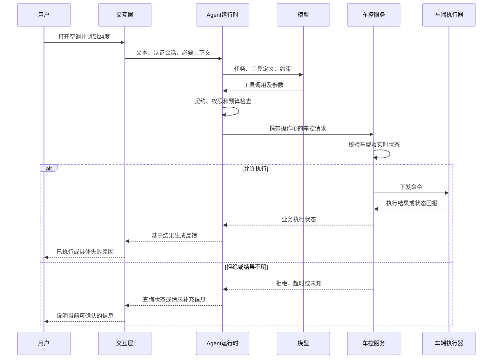
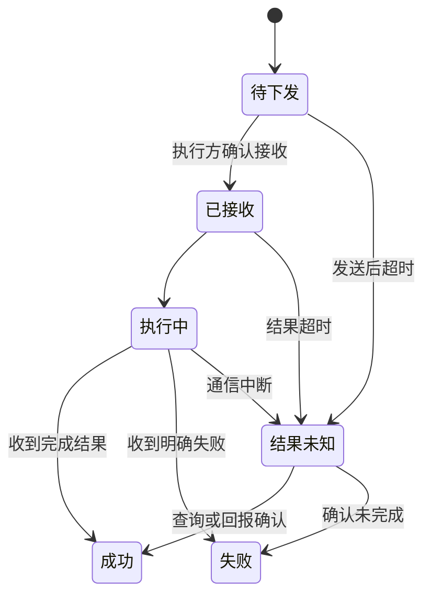
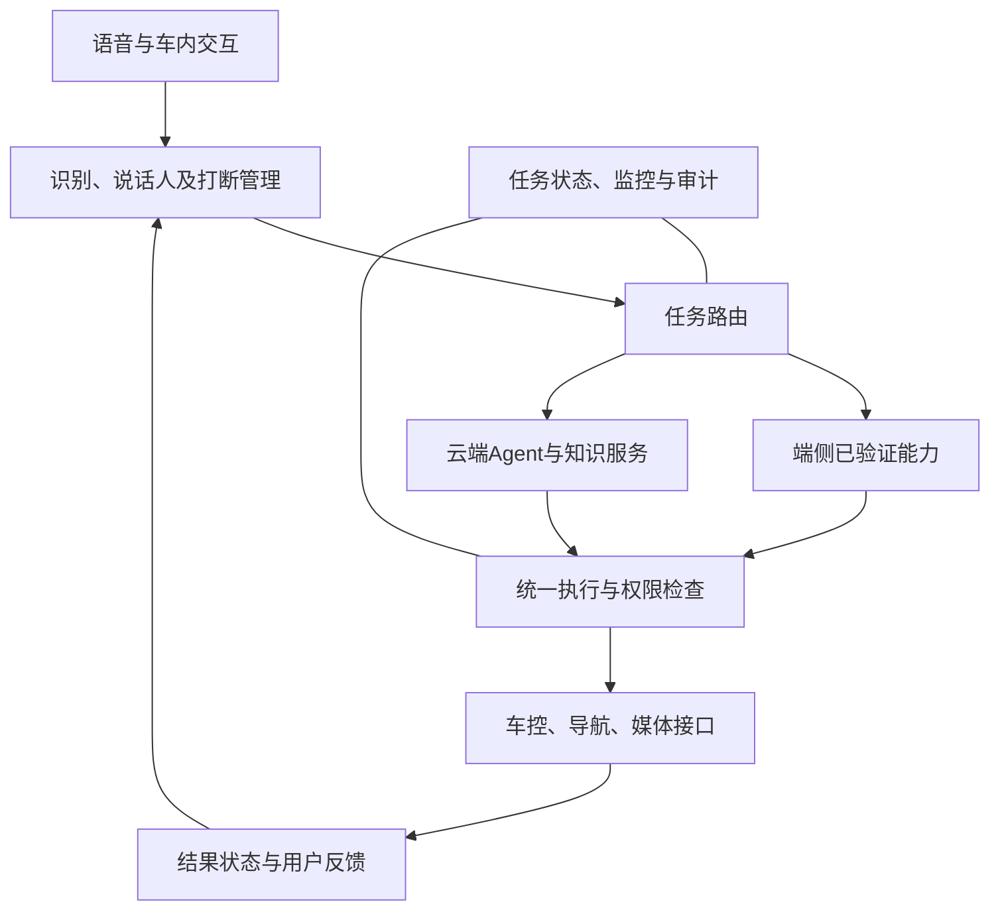
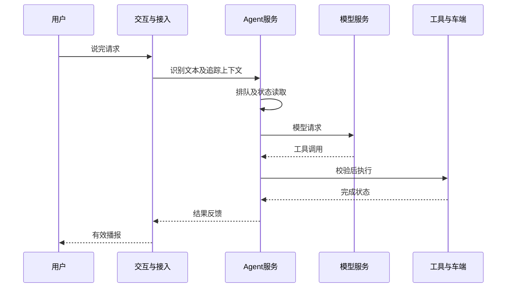
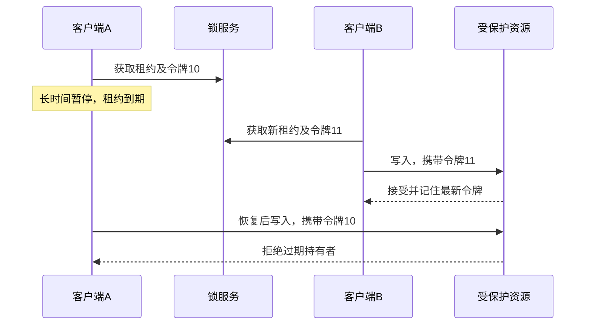

# 智能座舱云端 Agent：面试回答与问题详解

整理日期：2026-11-01。基于你提供的 43 题优化稿逐题核对，保留原编号。每题包含「1、面试回答」和「2、问题的详细讲解」；面试回答按约一分钟的主体回答组织，详细讲解供理解和追问使用，实际时长取决于语速。

以下车控架构均为面试设计示例，实际接口能力、操作许可和安全策略由车型及产品设计确定。文中的示例数据用于说明方法。

## 对优化稿的核对结论

整体方向正确：工具执行与模型输出分开、超时不等于失败、长期偏好与任务状态分开，以及按阶段评估 Agent，这些观点可以保留。需要修正或收紧的地方如下。

| 对应题目 | 原稿中需要调整的地方 | 本文采用的表述 |
|---|---|---|
| 2、3 | Skill 渐进加载容易与工具暴露、鉴权混为一谈；「查询类校验参数和权限就够了」过于简化 | Skill 组织操作知识，工具注册表和权限机制决定能否调用；查询还要控制数据范围、敏感信息和资源消耗 |
| 4 | 类型错误一律交给模型修正，可能掩盖对真实用户意图的猜测 | 格式错误可有限修复，缺失或歧义的业务值按规则补充或追问 |
| 12 | 只强调未完成调用的对应关系不够 | 对所有保留的工具消息检查调用 ID 和消息序列合法性，在一致边界压缩 |
| 13 | 「质量指标不下降才有意义」不适合直接作为统计判定 | 使用重复运行、分场景指标和预先设定的容忍界限；安全约束单独设门槛 |
| 14 | 部门、组织规则审批属于企业场景，不能直接当成座舱偏好设计 | 改成用户、音区、车辆及单次行程作用域，并处理共享车辆和换驾驶员 |
| 16、19 | QKV 并非只从最初 Embedding 生成；KV 缓存计算漏提当前 Q，头数也不够精确 | 每层由当前隐藏表示生成 QKV；缓存容量看 KV 头数，GQA 下不等于查询头数 |
| 22、23 | 端侧负责语音、云端负责 Agent 的分工容易说成必然 | 说明这是可选部署方案，Agent、ASR、TTS 均可因架构而端云分布 |
| 26 | 开后备箱的前置条件依车型而异；物理动作不能默认支持回滚 | 使用抽象依赖示例，失败后按已验证的停止或补偿策略处理 |
| 28 | 有请求 ID 和状态机，并不自动保证物理车控恰好执行一次 | 补充并发去重、持久化、执行与记录之间的故障窗口，以及车端支持要求 |
| 30 | 「座舱不能直接控车」容易和座舱能够发起车控相矛盾 | 明确是模型不能绕过受控车控接口和安全系统 |
| 31 | 基础语音必须留给供应商，缺少场景依据 | 根据接口质量、交付成本、性能和团队能力决定自研边界 |
| 34 | MRR 0.72→0.92、Top-5 93% 没有数据集和评测口径，不能据此核实结论 | 讲清指标定义及对照方法；个人成绩只在有真实证据时使用 |
| 36 | SSE 断线回放不等于链路追踪；流式阶段不能直接相加 | 补 Trace/Span 和阶段时间戳，按关键路径计算耗时 |
| 39 | 无显式主键不一定直接使用隐藏行 ID；显式主键也不一定缩小二级索引 | 补全 UNIQUE NOT NULL 的选择顺序，并说明主键越宽，二级索引通常越大 |
| 40、42 | 最左前缀和 Redis 锁的保障范围说得不够完整 | 区分索引访问方式和未使用索引；补租约失效、主从切换和栅栏令牌的前提 |

原稿中的「我们项目里」「我见过」「我的研究背景」及项目指标属于你的个人事实。单凭这份稿件无法确认实现、贡献和统计口径，本文主体统一使用设计回答；面试时可以补回能用代码、测试或实际案例解释的经历。

## 一、Agent 核心流程与工具调用

### 1. 从用户输入到工具执行，完整流程是什么？

#### 1、面试回答

我以「打开空调并调到 24 度」为例。交互链路先把语音转成文本，连同经过认证的会话信息、必要的车辆上下文交给 Agent。模型结合上下文和工具定义，生成设置空调的调用请求。运行时检查工具是否允许调用、参数是否合法，再由车控服务检查车型能力、身份权限和实时车辆状态，通过后才下发指令。收到车端执行结果后，系统更新任务状态，再告诉用户执行了什么。这里要区分已接收、已下发和已执行；接口返回已接收，不能直接说空调已打开。结果不明确时先查状态，仍无法确认就如实反馈。模型负责理解和提出动作，权限、执行与失败处理由程序控制。

#### 2、问题的详细讲解

完整流程至少涉及三种状态：用户期望的目标状态、服务端记录的命令状态，以及车辆实际状态。模型提出「设为 24 度」只改变了第一种信息；命令服务成功接收也不代表第三种状态已经改变。



首先，认证身份由可信会话提供，不能让模型生成用户 ID 来授权。其次，模型看到的车辆状态可能已经过期，所以执行服务要再次校验。最后，异步车控应通过命令状态查询或结果事件确认完成。审计记录中保留操作 ID、请求参数、执行状态和关联链路，便于追查部分成功与超时。每多一道校验会增加耗时，但需要避免把接收成功误判为物理执行成功。

### 2. 模型怎么知道该调哪个工具？

#### 1、面试回答

我们会把工具名称、用途、参数结构和限制提供给模型，模型根据用户意图生成工具名和参数。工具较多时，我会先按权限和车型能力过滤，再根据任务检索候选，减少上下文和相似工具之间的干扰。Skill 可以按需提供操作说明，但工具是否注册、是否可见、能不能执行，需要运行时分别控制。模型选完之后，程序还要检查工具和参数；查询类同样要控制可查的数据范围和敏感信息，车控类还要检查车辆实时状态。如果模型没有选到合适工具，可以扩大候选或追问，不能把检索不到直接解释为车辆不支持。

#### 2、问题的详细讲解

这里有四个不同环节：注册表记录系统实现了哪些工具；可见性过滤决定本次向模型提供哪些定义；工具检索减少当前候选；执行鉴权决定这次请求能否真正调用。前三个环节都不能替代第四个。

例如系统支持「当前车辆空调状态」和「账户下全部车辆状态」，描述相似但授权范围不同。即使模型选择了后者，也必须由服务端约束实际可访问车辆，不能信任模型提交的车辆 ID。工具检索还存在漏召回，需要准备扩大搜索或澄清分支。

Skill 渐进加载主要减少一次性加载的说明内容；除非宿主实现了工具动态挂载，否则加载 Skill 不代表自动加入工具。相关概念可核对 [Agent Skills 规范](https://agentskills.io/specification)。

### 3. 工具怎么接入？MCP 是必须的吗？

#### 1、面试回答

工具可以接内部函数、HTTP、RPC，也可以通过 MCP，选择取决于现有系统和复用需求。如果只是一个 Agent 调内部车控服务，我会先封装工具适配器，复用已有的 RPC 鉴权、超时和治理能力。多个客户端需要以统一方式发现和调用一批工具时，MCP 的标准协议比较有价值。接入时需要把工具参数、调用身份、错误码和业务结果映射清楚。例如 RPC 返回请求已接收，适配器不能包装成执行成功。无论使用哪种协议，服务端都要保留授权、超时、幂等和审计能力；引入 MCP 的收益要与适配和维护成本一起评估。

#### 2、问题的详细讲解

MCP 定义的是客户端与服务端的交互协议，其中工具能力包含发现、输入结构与调用结果等。它不会自动实现业务权限或车控安全规则。典型路径是「Agent 运行时 → MCP 客户端 → MCP 服务端 → 内部业务接口」，也可以省掉 MCP，直接调用内部适配器。

适配层要统一两类错误：通信失败，例如连接超时；业务失败，例如车型不支持。模型看到可处理的错误摘要，运维侧保留详细诊断信息，同时避免把内部地址、凭证和堆栈暴露到回答中。

协议统一有利于跨客户端复用，但多一层服务可能引入版本兼容、网络往返和身份传递问题。选型依据是客户端数量、工具复用范围和已有治理体系。协议细节见 [MCP 工具规范](https://modelcontextprotocol.io/specification/2025-06-18/server/tools)。

### 4. 工具参数怎么设计？参数错了怎么办？

#### 1、面试回答

我会让参数语义明确、类型确定，并且能够做业务校验。比如温度写清摄氏度、车型支持的范围和步进，音区使用明确枚举。调用到达后，先检查必填项、类型和额外字段，再检查车型能力、权限及车辆状态。格式错误可以把具体字段错误返回给模型，允许有限修复；业务值缺失或有歧义时，如果没有明确默认规则，就向用户追问。例如用户只说调高一点，可以按产品定义的步长处理，不能让模型随意猜一个值。身份、车辆归属等授权参数由服务端确定。修复次数也要设上限，避免模型反复生成相同错误。

#### 2、问题的详细讲解

结构合法不代表业务正确。温度是数值，但 100 度不符合车辆能力；车辆 ID 格式正确，也不代表用户有权限控制。校验应按「结构 → 业务范围 → 身份权限 → 实时状态」逐层进行，执行前完成关键检查。

车型相关范围可以由动态能力接口提供，避免把所有车型写死在一个静态 Schema 中。能确定的单位转换可由程序完成；涉及用户真实意图的歧义应追问。错误结果应区分可修复、需澄清和禁止执行，禁止把所有拒绝都交给模型尝试绕过。

即使接口提供约束生成能力，它通常也只能降低格式错误，无法证明调用符合业务意图。代价是契约维护和车型适配工作增加，收益是错误在进入车控链路前被明确拦截。

### 5. 同一个问题多次运行，工具调用顺序会不同吗？

#### 1、面试回答

有可能。即使用户问题相同，上下文、实时状态、工具结果或模型服务条件不同，也可能产生不同轨迹，温度设成零也不能当作绝对确定性的保证。独立查询可以按不同顺序或者并行完成；有依赖和副作用的步骤，需要由执行器检查顺序和前置条件。例如必须先确定地点，才能发起导航。评测时我会允许等价的合法路径，同时检查最终结果、参数和中间安全约束。不能只按一条固定轨迹判分，也不能因为最终结果正确就忽略中途的越权调用。

#### 2、问题的详细讲解

不确定性既来自生成，也来自环境：同一地点的充电空位变化，会合理地触发不同选择。评测可分为三层：动作是否允许、依赖是否满足、最终任务是否成功。查询天气和路况先后颠倒可以接受；用户尚未确认就导航，即使最终路线正确也不应通过。

回放时需要固定模型版本、提示词、工具定义和模拟工具响应，降低环境差异；仍应对生成波动进行重复采样。对高风险关键路径，可以让模型只提供结构化候选，由确定性执行器控制实际步骤。自由度减少会限制开放任务，但能减少不可预测的动作序列。

### 6. 工具超时、失败、重复执行怎么处理？

#### 1、面试回答

先区分永久错误、暂时错误，以及执行结果未知。参数不合法或权限不足，直接修正或停止；查询服务暂时超时，可以在总预算内做带退避的有限重试。有副作用的车控超时后，不能直接判失败重发，因为可能已经执行，只是回包丢了。我会为逻辑操作保留稳定的请求 ID，先查命令状态；只有执行方明确支持幂等或能够确认未执行，才决定重试。状态确认不了就进入结果未知并继续对账，同时告知用户。调用方的取消也不能自动撤销已发生的物理动作，最终要依据执行方状态处理。

#### 2、问题的详细讲解

例如车端已经打开车窗，但云端等待结果超时。云端若切换端侧重新执行一次「再打开一点」，就会重复产生副作用。所以重试策略必须同时覆盖云端和端侧，不能各自生成新请求。



状态未知需要保留操作和关联 ID，由查询或异步回报收敛。失败也应区分是否可能部分执行。重试采用总截止时间、最大次数和退避，防止故障时放大流量。幂等机制的物理执行边界见第 28 题。

### 7. 为什么用 Agent 动态规划，不用固定 Workflow？

#### 1、面试回答

我会根据任务的不确定性和错误成本选。开空调、设置温度这些步骤明确的操作，固定流程更容易验证，响应也稳定。找一家顺路、有停车位且适合充电的餐厅，需要根据检索结果调整目标，适合让 Agent 动态规划。实际可以让模型负责理解开放目标和提出方案，再由固定执行器完成敏感操作。Workflow 里也能包含模型节点，Agent 也可以调用固定子流程。我的判断标准是：流程变化是否真的需要模型，以及为了灵活性增加的延迟和失败概率是否值得。

#### 2、问题的详细讲解

固定流程显式列出状态和分支，优点是覆盖范围可检查；缺点是需求复杂后分支维护成本高。动态规划让模型根据观察选择动作，能适应开放输入，但步骤数、调用费用和结果稳定性更难控制。

例如「先导航回家，再打开音乐」只需要少数已知步骤，使用动态规划未必有收益。对于开放的餐厅推荐，仍应让数据库或地图服务提供真实候选，不能让模型编造商家。混合方案需要明确哪些节点可由模型决策、哪些条件由程序强制检查，避免动态路径绕开固定流程中的确认节点。

### 8. ReAct 怎么组织任务规划和执行？

#### 1、面试回答

ReAct 把模型决策、外部动作和结果观察交替起来。比如找充电站，模型先选择搜索工具，运行时执行并把候选结果返回，模型再判断是否需要查空位、换候选或结束。每次循环前后都要更新任务状态，并检查总时间、最大步骤、重复调用和用户取消。工具错误按类型处理：缺参数就澄清，暂时失败才有限重试，权限拒绝则停止。工程上需要保存工具动作和观察结果，方便恢复和排查；不需要依赖展示模型的完整内部思考。它适合需要根据中间结果调整的任务，但多轮模型调用会增加延迟和成本。

#### 2、问题的详细讲解

一次循环输入包含当前目标、必要历史、工具定义和上一轮结果。输出可能是工具调用，也可能是最终回答。执行器必须先检查调用是否合法，再把实际结果回填，并保留调用 ID。

防死循环不能只统计步数，还可以识别重复的工具与参数、长时间无状态进展，以及预算耗尽。假设连续三次搜索相同地点都无结果，再调用并不会增加信息，应改变条件或向用户解释。

现代实现可以只记录决策摘要、可见动作和结果。ReAct 的思想并不要求向用户暴露私有推理。保存完整中间数据有利于调试，但需对敏感内容脱敏并设置保存期限。

### 9. Plan Mode 怎么拆任务、排顺序？

#### 1、面试回答

我把计划模式理解为先明确目标、步骤和依赖，再执行，并在环境变化时修订。比如查目的地附近的充电站，先获得候选集合，再并行查询候选详情，筛出可达站点，最后确认并导航。计划要包含输入、完成条件、失败分支和确认点。这里要区分两个概念：有的产品中 Plan Mode 只是只读规划，用户确认后才进入执行模式；有的系统说的是规划后执行的架构模式。所以我会先说明当前语义。计划被确认后也不能绕过执行时的权限和实时状态检查，必要时只重做受影响的步骤。

#### 2、问题的详细讲解

计划可以表达成有向无环图：节点是子任务，边表示数据或执行依赖。先查询候选，才能查询各站详情；各详情查询之间可以并行；导航依赖目标站点已选定。已有用户偏好或缓存可减少部分步骤，但要检查有效期。

动态任务不一定始终是无环图，可以通过「生成一版计划 → 执行 → 重规划」处理循环和变化。重规划要记录已经发生的副作用，不能把已完成车控当成未执行节点重跑。若目标、风险或执行参数发生实质变化，旧确认可能失效，需要重新确认。计划的价值是约束依赖和管理失败，代价是额外规划开销。

### 10. 多 Agent 怎么分工和协同？

#### 1、面试回答

我会先判断是否真的需要多个 Agent。若只是查天气、地图和电量，单 Agent 调几个工具通常就够了。子任务能独立推理、需要不同上下文或独立校验时，再考虑由主 Agent 拆解，子 Agent 分别处理后汇总。接口上约定输入、输出、权限、预算和截止时间，跨 Agent 的关键状态由统一任务存储管理。还要避免多个 Agent 同时修改同一导航目标或重复下发车控。多 Agent 的收益是并行和职责分离，代价是同步、调用和调试成本，所以我会用任务收益来证明拆分必要性。

#### 2、问题的详细讲解

「专用工具」和「专用 Agent」不同：工具执行一个明确操作，Agent 通常还拥有自己的模型循环和决策空间。把简单查询全部包装成子 Agent，会增加调用次数，却未必提高效果。

需要协作时，可以让主 Agent 管理任务图，子 Agent 只返回结构化结果和来源。对同一车控对象采用单一执行入口，避免每个 Agent 都能直接写车辆状态；取消与超时要向下传递，子任务预算也计入总预算。并行可以降低独立任务的墙钟耗时，但无法消除汇总和冲突处理开销。是否拆分取决于任务独立性、上下文隔离收益与额外协调成本。

## 二、上下文、记忆与用户偏好

### 11. 多轮对话怎么保存任务状态、处理指代？

#### 1、面试回答

我会把当前目标、候选、用户约束、待确认动作和执行结果保存成结构化状态。用户先说去北京南站，再补一句避开高速，就是更新当前导航任务的约束，并重新检查原方案。状态带版本，提交时检查自己读取的版本是否仍有效，避免旧请求覆盖新条件。对于换一家、去那边这类表达，结合当前候选解析；不能唯一确定就追问。用户取消、切换话题或修改关键参数时，还要使旧计划和确认失效。聊天记录用于理解，真正驱动执行的是经过校验的任务状态。

#### 2、问题的详细讲解

例如用户确认了 A 充电站，紧接着改成 B。如果旧线程仍拿着 A 的确认继续下发导航，就出现状态竞争。版本检查应在提交计划、消费确认和执行关键动作时生效，而不只是存一个版本号。

实现上可按会话串行处理，或采用条件更新：只有版本与预期一致，才允许迁移状态。发生冲突时重新读取并判断，而不是无条件重试旧动作。指代解析还要保存候选 ID、展示顺序和当前焦点，避免只保留一段候选摘要。结构化状态便于恢复和审计，代价是状态模型与迁移规则需要持续维护。

### 12. 上下文太长有哪些压缩策略？

#### 1、面试回答

我会组合近期窗口、历史摘要和按需检索：近期交互保留原文，较早内容提取目标、约束与结果，历史细节需要时再查。压缩前先计算输入预算，并为输出和工具返回留空间。目的地、待确认动作、命令状态这些关键数据单独保存，不能依赖摘要作为唯一记录。消息裁剪也要遵守接口协议，工具调用和结果通过调用 ID 配对，不能留下孤立结果或错误截断进行中的调用。压缩之后校验摘要、状态和消息结构，再继续执行；失败时保留旧版本或安全降级，避免连续压缩却没有减少内容。

#### 2、问题的详细讲解

短期上下文管理解决单次会话窗口有限的问题；长期记忆解决跨会话事实保存的问题，两者可以交互，但用途不同。检索历史也会漏召回，所以影响执行的当前状态必须有确定存储。

一次安全压缩流程是：确定一致边界、提取不可丢状态、生成摘要、核查关键约束、重建合法消息序列、测量实际 Token，再提交新上下文。并行工具尚未完成时，可等待它们结束或把整个未完成片段保留，不能只保留其中一半。

压缩还会改变提示词前缀，可能影响前缀缓存命中；应避免频繁改写稳定内容。收益是上下文容量和费用可控，代价是摘要调用耗时、信息损失和实现复杂度。

### 13. 怎么评估压缩有没有丢关键信息？

#### 1、面试回答

我会准备带关键事实和完成标准的多轮任务，用相同模型、工具响应和输入做压缩前后对比，并重复运行处理生成波动。看事实保留、约束遵守、任务完成率、错误动作，再看 Token、时延和成本。比如用户早先要求避开高速，压缩后仍必须遵守。质量上先设定允许的变化范围，安全问题单独设门槛，不能用平均分抵消。还要覆盖连续多次压缩，因为单次摘要没丢信息，不代表滚动压缩后仍然可靠。如果完整上下文本来就超过窗口，就在能比较的样本上做对照，长样本用独立标注的标准评估。

#### 2、问题的详细讲解

事实保留率可以用已标注的目的地、预算、否定约束和执行状态检查；任务成功则通过模拟工具或实际系统结果验证。两者不相同：摘要文字保留了「避开高速」，模型后续仍可能没有遵守。

对照实验固定模型与工具环境，比较每个任务的差异，并报告重复采样的波动或置信区间。预先设置可接受的性能与质量权衡，避免看到结果后再改标准。零次观察到误执行不等于风险为零，仍要依赖执行层控制。

另外，完整上下文可能有噪声，压缩有时会提高效果，不能把完整历史当作绝对正确答案。实际标准应该来自任务标注和业务要求，而非另一组模型输出。

### 14. 用户偏好怎么存？为什么可能异步？

#### 1、面试回答

我会区分本次任务条件和长期偏好。用户说这次避开高速，只作用于当前行程；多次明确表示喜欢某个温度，才考虑形成长期偏好。存储时记录用户、车辆或音区作用域，以及来源、时间、置信度和删除状态。共享车辆不能把一名乘员的习惯直接应用给所有人。偏好提取可以放后台，减少响应延迟，但当前任务刚修改的条件要立即在会话中生效。异步写入还要做去重和版本检查，避免用户删除之后又被旧任务写回。安全策略不由偏好覆盖，用户也应能查看、修改和清除记忆。

#### 2、问题的详细讲解

一次说「今天很冷，调到 26 度」不足以推断全年偏好 26 度。提取器应保留语境，区分暂时条件、显式长期偏好和低置信度推断。使用顺序可按产品定义为当前明确指令优先、用户偏好次之、车辆默认最后，安全限制始终独立生效。

异步链路包含事件入队、候选提取、作用域校验、冲突合并和落库。给事件稳定 ID，并检查用户与记忆的版本，防止重复消费和过期写入。删除应有版本或删除标记，避免后台老任务重新生成已删除记录。

企业记忆中的部门晋升审批可以作为迁移经验，但座舱首先要解释清楚驾驶员、乘员、音区和车辆共享边界。

## 三、大模型与 Transformer

### 15. Encoder-Decoder 和 Decoder-only 有什么区别？

#### 1、面试回答

主要区别是输入输出之间的信息流。Encoder-Decoder 中，编码器通常可以双向读取整个输入，解码器用因果自注意力生成输出，并通过交叉注意力读取编码器结果，翻译这类输入输出边界明确的任务很适合。Decoder-only 在同一个序列中用因果注意力预测下一个 Token，问题和回答可以统一组织成前缀及续写，便于做对话和指令任务。因果限制也不代表处理提示词时必须逐个算，训练和预填充仍可以并行处理多个位置。选型还要看模型能力、训练目标、延迟和部署成本，不能只凭架构名字判断效果。

#### 2、问题的详细讲解

| 维度 | 典型 Encoder-Decoder | 典型因果 Decoder-only |
|---|---|---|
| 输入表示 | 编码器通常双向编码输入 | 提示词各位置遵守因果可见性 |
| 输出生成 | 因果自注意力，加对编码结果的交叉注意力 | 对前缀和已生成内容做因果自注意力 |
| 信息边界 | 输入序列与输出序列分开 | 同一序列中组织提示和续写 |
| 推理缓存 | 可缓存解码器自注意力，以及固定编码结果相关投影 | 逐步扩展各层自注意力 KV 缓存 |

以「英文翻译成中文」为例，编码器读完整英文，解码器每一步既看已生成中文，又读取英文表示。Decoder-only 则把任务说明和英文作为前缀，继续生成中文。两类模型都能完成翻译、摘要等任务，差别不构成任务能力的绝对限制。

训练可并行计算已知序列各位置，生成却需要上一 Token 的采样结果，因此仍有自回归的串行部分。基本结构可核对 [Transformer 原始论文](https://arxiv.org/abs/1706.03762)。

### 16. Transformer 里 Q、K、V 怎么算？

#### 1、面试回答

在每一层注意力中，当前隐藏表示分别经过三个线性投影，得到 Q、K、V；第一层输入与 Embedding 有关，后面用的是前面层处理后的表示。位置信息按模型设计融入，例如先对 Q、K 做旋转位置编码。随后用 Q 和 K 的转置相乘得到分数，除以根号 dk，加入遮罩并经过 Softmax，最后对 V 加权求和。因果注意力允许当前位置看自己和历史，屏蔽未来位置。多头结果拼接后再做输出投影。交叉注意力则不同，Q 来自解码器，K、V 来自编码器表示。

#### 2、问题的详细讲解

设一层输入 X 的形状为「序列长度 n × 隐藏维度 d」，单个头的投影得到 Q = XWq、K = XWk、V = XWv。若 Q、K 每个位置的维度为 dk，QKᵀ 就是 n × n 的位置相关性矩阵。Softmax 沿每个查询对应的键位置归一化，再乘 V 得到该查询聚合的内容。

可写成：Attention(Q,K,V) = softmax(QKᵀ / √dk + mask)V。位置编码的具体形式依模型而异；例如旋转位置编码作用于 Q、K，不能一概说所有模型都只在 Embedding 上加位置向量。

小例子：某查询对两个位置的归一化权重为 0.75 和 0.25，则输出是两处 V 的加权和。这解释了分数由 QK 决定、被聚合的内容来自 V。原理参考 [缩放点积注意力](https://arxiv.org/abs/1706.03762)。

### 17. 为什么注意力分数要除以 √dk？

#### 1、面试回答

目的是控制点积分数的尺度。在 Q、K 各分量近似独立、均值零、方差一的假设下，点积是 dk 项乘积求和，方差大约是 dk，标准差就是根号 dk。维度越大，分数越容易拉开，把 Softmax 推向非常集中的区域，影响梯度和训练稳定性。除以根号 dk 后，分数的方差回到常数级别。这里说的是典型统计解释，真实模型还受归一化和训练分布影响；这个缩放本身也不能保证注意力一定平滑，只是控制一种随维度增长的数值效应。

#### 2、问题的详细讲解

假设 dk 为 64，点积的标准差约为 8，除以 √64 = 8 后，标准差回到约 1。若除以 dk，则会缩小得更多，维度增长后分数可能过于平坦；因此用标准差尺度做归一化更自然。

Softmax 的输出若接近 one-hot，部分方向的导数可能非常小，模型难以调整权重。应避免说「大分数必然使所有训练梯度为零」：梯度还与损失函数、其他计算路径有关，缩放也不能完全消除极端分数。

dk 指每个头中键、查询的点积维度，通常不等于整个隐藏维度。解释来自 [Transformer 论文的缩放点积注意力设计](https://arxiv.org/abs/1706.03762)。

### 18. 为什么需要多头注意力？有哪些变种？

#### 1、面试回答

多头注意力让多个不同投影空间分别计算位置关系，再合并结果，增加模型同时表示不同关联的能力，但不保证每个头都有固定可解释含义。常见优化有两类：MQA 让多个查询头共用一组 K、V，GQA 让一组查询头共用 K、V，重点减少缓存和解码阶段的内存读取；局部或稀疏注意力限制能关注的位置，减少长序列的计算和缓存需求。两类方法可以组合。需要注意，GQA 依然可能对完整历史做注意力，不会仅因为共享 K、V 就把预填充的全注意力计算变成线性复杂度。

#### 2、问题的详细讲解

| 形式 | 查询头与 KV 头的关系 | 主要收益与代价 |
|---|---|---|
| MHA | 通常每个查询头有对应 KV 头 | 表达灵活，KV 缓存较大 |
| MQA | 全部查询头共享一组 KV | 缓存小，可能损失质量 |
| GQA | 查询头按组共享 KV | 在共享程度和效果之间取舍 |
| 局部或稀疏注意力 | 限制可访问位置 | 减少计算，但可能损失某些远程联系 |

假设有 32 个查询头，MHA 使用 32 个 KV 头，某 GQA 使用 8 个，MQA 使用 1 个。在其他因素相同时，KV 缓存容量按 KV 头数缩减；但真实加速还受计算内核、带宽和批大小影响。

固定窗口 w 的局部注意力可使相关计算规模接近 n×w，而完整注意力通常是 n² 规模。稀疏模式不同，复杂度也不同。GQA 的取舍见 [GQA 论文](https://arxiv.org/abs/2305.13245)。

### 19. 什么是 KV Cache？有什么代价？

#### 1、面试回答

在因果解码器中，历史位置不会看到后来的 Token，所以已有的 K、V 可以复用。预填充时先处理提示词并建立缓存，解码时每层只计算新位置的 Q、K、V，把新的 K、V 加入缓存，再让当前 Q 读取允许访问的历史缓存。它省掉了反复处理历史位置的计算，但没有省掉当前查询对历史键和值的读取。代价主要是显存和带宽，容量与层数、序列长度、并发数、KV 头数、头维度和数据精度有关，GQA 下要看 KV 头数。优化时还要考虑缓存管理和批处理，不能认为缓存越多吞吐就一定越好。

#### 2、问题的详细讲解

对普通完整注意力的 Decoder-only 模型，未分片、未共享时的 KV 数据量可近似为：2 × 层数 L × 序列长度 S × KV 头数 Hkv × 头维度 D × 每元素字节数 b，再对各并发序列求和。系数 2 代表 K 和 V。

例如 L=32、S=8192、Hkv=8、D=128、b=2，一条序列的 KV 约为 1 GiB。这里未计分页碎片、运行时元数据和其他显存；若做张量并行、前缀共享、缓存量化或使用不同注意力结构，实际分布会改变。

一般不缓存历史 Q，是因为下一步只需要新查询，历史查询的输出已经计算过。缓存可复用还要求模型、位置处理、前缀和相关配置匹配；不能把修改过的上下文直接接到旧缓存上。逐层缓存机制参考 [Hugging Face 缓存说明](https://huggingface.co/docs/transformers/main/en/cache_explanation)，KV 头共享的定义参考 [GQA 论文](https://arxiv.org/abs/2305.13245)。

### 20. 什么时候需要微调？LoRA 是什么？

#### 1、面试回答

我会先判断问题来自知识、行为还是系统执行。知识经常更新，优先检索；工具超时和业务权限错误，先修系统。希望模型稳定学习领域表达、分类边界或调用模式，而且有高质量样本时，再评估微调。LoRA 冻结基础权重，用两个较小矩阵的乘积表示一部分权重增量，只训练少量参数，减少可训练参数和优化器状态。它通常能降低训练与适配成本，但不代表基础模型不用加载，也不能保证完全遵守安全规则。我会用独立测试集比较提示词、检索和微调方案，确认收益覆盖数据与维护成本后再选择。

#### 2、问题的详细讲解

若原权重 W 的形状为 m×n，全量更新涉及 m×n 个参数；LoRA 用 ΔW=(α/r)BA，其中 B 为 m×r、A 为 r×n，新增参数约为 r(m+n)。当 r 远小于 m、n 时，可训练参数明显减少。比如 m=n=4096、r=8，新增约 6.6 万参数，而原矩阵约有 1678 万参数。

冻结原权重不等于训练不占基础模型显存，前向、反向传播及激活仍有成本。兼容的适配器可合并回权重；动态加载多个适配器则需要额外管理。结构化输出也可先尝试契约约束，不必立刻微调。

数据拆分应防止同一模板或近重复样本泄漏到测试集，并检查微调是否损害其他能力。定义与低秩更新方法参考 [LoRA 原始论文](https://arxiv.org/abs/2106.09685)。

### 21. 怎么预测车辆行驶中的弱网？选什么模型？

#### 1、面试回答

我会先定义未来多长时间内、什么条件算弱网，比如请求失败率或可用吞吐低于业务阈值。输入可以用当前可获取的信号质量、运营商、位置、速度和沿途历史网络表现，先做位置查表和统计规则基线。再根据数据尝试树模型、LSTM 或 Transformer，比较漏报、误报、提前量和推理成本。训练测试要按时间、行程和区域隔离，避免相邻轨迹造成虚高分数，也不能使用预测时尚未知的未来网络信息。最终还要验证预测是否帮助提前缓存或切换端侧能力，只有离线准确率高还不够。

#### 2、问题的详细讲解

标签可定义为「未来窗口内是否连续一段时间达不到服务要求」，这样比单个信号值更贴近用户体验。弱信号不必然等于业务不可用，网络拥塞、时延和丢包也会影响结果，因此特征和标签应与应用目标匹配。

样本稀少时，地理覆盖统计更容易落地；表格特征丰富时可先用 GBDT；需要利用长时序依赖且有足够数据时，再考虑序列模型。阈值选择取决于误报的缓存成本和漏报的交互损失。

评测可留出未来时间段和未见区域，同时报告已知道路与新区域的差异。训练时可用实际未来网络做标签，但输入特征只能使用当时已知的信息。上线先观察预测，再小范围启用预取策略，控制额外流量。

## 四、智能座舱与端云协同

### 22. 怎么设计一个车内语音助手 Agent？

#### 1、面试回答

我会拆成交互、Agent、业务工具，以及贯穿全链路的安全、状态和可观测能力。交互处理唤醒、识别、播报和打断；Agent 处理意图、多轮状态、规划和工具选择；业务工具连接车控、导航和媒体。部署上保留满足基本需求的端侧路径，复杂问答和规划可以使用云端，但 ASR、TTS 和 Agent 的具体位置根据延迟、算力和隐私要求决定。以我有点冷为例，系统先理解是想调空调还是普通描述，根据明确规则执行或追问。最后基于车端结果反馈，并覆盖弱网、多人和取消，安全检查始终位于执行链路中。

#### 2、问题的详细讲解



首先由交互层识别输入并管理当前发言状态；路由根据任务和网络决定端云路径；两条路径的动作都经过受控执行入口；接口结果回写状态，再交给交互层播报。云端异常时，路由只选择确有能力的本地路径，不能用生成回答假装执行。

安全和状态不是所有请求必经的「最底层」，而是路由、规划、执行和反馈都要使用的横向能力。端云可拆分部署，但需要共享命令身份和结果语义，避免两边独立执行同一动作。

### 23. 模型放车端还是云端？端云怎么切？

#### 1、面试回答

我会看离线可用性、端到端时延、算力和功耗、数据隐私，以及迭代成本。基础车控如果有经过验证的本地能力，优先保证断网也能用；开放问答和复杂规划可以用云端更强的模型和外部信息。实际不是按任务名字一刀切，同一意图也可以有本地基本路径和云端增强路径。切分时明确路由权威和操作 ID，避免端云同时执行；偏好同步也要按版本和作用域处理。云端失败后，只降级到已验证的本地能力。选择依据是每种能力在目标网络和硬件条件下的实际效果与成本。

#### 2、问题的详细讲解

可以为每项能力建立表格：是否依赖联网、可接受时延、隐私敏感度、端侧资源占用、允许的错误和降级方式。车端模型不一定总快，硬件竞争和模型冷启动可能抵消网络收益；云端也不一定总准，需要测试真实口音、车型和工具环境。

路由变化必须保持操作连续性。例如云端已经接收空调指令，网络转弱时，端侧先接管交互并查询状态，而不是重新创建相同命令。全局配置可以有权威版本；离线产生的用户偏好需要按字段和来源合并，时间戳不能单独解决所有冲突。

端云协同提高可用性，但增加版本兼容、状态同步和重复执行风险，这些应计入方案成本。

### 24. 车载弱网或云端不可用怎么降级？

#### 1、面试回答

先按阶段区分连接失败、云端超时和工具异常，再按能力降级。本地能独立完成的基础车控，可以路由到已验证的端侧能力；实时搜索暂不可用时说明情况，缓存结果必须标出时间和适用范围。已经发出去的车控先查状态，不能切换端侧后再执行一遍。多轮任务保留目标和约束，但网络恢复后要重新校验过期候选、权限和确认。实现上使用总截止时间、熔断和探测恢复，防止网络差时一直重试。弱网预测可以提前缓存，但不能代替当前网络和车辆状态检查。

#### 2、问题的详细讲解

降级可以拆成三件事：减少功能范围、切换执行位置，以及延后可延后任务。比如联网问答失败，不必影响本地空调控制；但充电桩当前空位不能用昨天的缓存冒充。

如果命令已经成功发送，切换路径时必须延续同一个逻辑操作身份。网络恢复也不等于自动执行离线期间所有旧指令，用户可能已经改变意图。对有副作用的待执行操作，应检查有效期、最新状态及是否需要重新确认。

熔断打开后暂停高概率失败请求，间隔探测服务恢复，避免全部流量同时重连。更强降级需要维护本地能力和兼容矩阵，不能仅靠服务端捕获异常实现。

### 25. 车内噪声、打断、多人说话怎么处理？

#### 1、面试回答

噪声侧结合麦克风阵列、回声消除、降噪和语音识别，并在行驶、开窗、音乐等条件下分场景测。打断要分清停止播报、停止模型生成和取消业务动作：用户说话时可以先停止播报，但已经下发的车控能否取消由执行服务确认。对迟到的语音片段和工具结果，用会话轮次或版本判断，避免旧回答继续播放。多人说话时结合音区和说话人信息，但声纹不能单独作为敏感操作授权依据。识别不确定、说话冲突或动作含糊时，优先澄清，并依据产品定义处理驾驶员和乘员权限。

#### 2、问题的详细讲解

系统播报会被麦克风再次采集，回声消除负责抑制自身播报；语音活动检测和结束判断影响是否误把噪声当打断、是否过早截断用户。字错率之外，应评估关键槽位和完整任务成功率，因为地名识错一个字可能直接影响导航。

打断可沿「交互轮次取消 → 模型请求取消 → 尚未下发动作取消」传播；已执行的动作无法靠丢弃回答撤销。旧请求晚到时，结果可用于更新命令状态，但不能覆盖新轮次的目标或自动播报旧结论。

多人并发指令还需要仲裁，例如两个音区同时改共享媒体音量。仲裁规则由产品与安全策略决定，不能把说话更大声作为权限依据。

### 26. 一句话有多个车控动作，怎么理解和执行？

#### 1、面试回答

我会先抽取动作、参数、作用对象及依赖，再由执行器检查。例如打开空调并调到 24 度，可以调用支持开关和温度的一体接口；不支持时，按接口定义的依赖执行。并行只用于确实独立且不会争抢设备的动作。执行前统一校验，关键步骤执行时再检查实时状态。结果按动作记录，部分成功就明确说明哪项完成、哪项失败。失败后可以停止后续步骤，补偿只能用事先验证过的方案；物理动作未必可回滚。还要把每个子动作绑定到同一任务，并给子动作独立的幂等身份，便于超时后查询。

#### 2、问题的详细讲解

一个请求包含多个属性，不代表执行接口承诺原子性。必须阅读业务契约：要么整体失败，要么可能部分生效。如果接口只提供批量接收，调用方仍需获取每个动作的结果。

任务可先做预检，再按依赖图执行。预检通过后车辆状态仍可能变化，因此执行端应再次检查。两个动作互相覆盖时，例如先设 24 度又设 26 度，应结合用户语义判断修正还是顺序操作。

物理补偿不是数据库事务回滚：开过车窗后再关闭，不能恢复期间进入的雨水。只有补偿本身安全、被授权且符合用户意图时才使用；否则停止并反馈。不要把某车型的开门或后备箱依赖当作所有车型通用事实。

### 27. 车窗、车门这类操作怎么做安全确认？

#### 1、面试回答

先由产品和车辆安全规则定义风险等级、允许状态和确认要求。执行前检查身份、车速、车型能力和当前状态；需要确认时，把具体对象和动作说清楚，再等待明确答复。确认要绑定用户、车辆、动作参数、任务版本和有效期，不能让一句好的授权另一条后来生成的动作。用户修改关键参数、切换说话人或确认过期时，要重新判断是否确认。真正执行前再检查实时状态，因为确认期间车辆可能已开始行驶。权限不足或动作被禁止时，用户再次说确认也不能绕过限制。

#### 2、问题的详细讲解

这类问题包含授权、确认和执行条件三个不同判断：授权决定谁可以做；确认决定用户是否同意当前具体动作；车辆状态决定现在是否允许做。三者都满足才可执行。

典型竞争是「停车时确认 → 等待期间车辆起步 → 旧动作继续执行」，因此检查要靠近实际动作发生位置，并由可信的车控服务或控制器执行。云端采集到的旧车速只适合上下文参考。

确认记录被消费时可做版本检查或原子状态迁移，阻止重复消费；但这仍不替代底层去重。增加确认会增加交互成本，适用于哪些动作需要由真实安全需求决定，不应所有动作都机械增加一次询问。

### 28. 怎么保证车控指令不被重复执行？

#### 1、面试回答

我会从逻辑操作到最终执行方建立幂等边界。一次用户意图生成稳定操作 ID，重试沿用；执行端校验同一 ID 的参数一致，通过原子占用防止并发重复，并持久化状态和结果。查询超时优先查已有状态。关键是请求 ID 本身不能保证物理动作只发生一次：执行成功后、结果落库前宕机，仍可能无法判断。所以需要车端控制器支持去重和状态查询，或用可验证的目标状态控制；不具备这些能力时，只能明确保障范围并保留未知状态。尤其上调一度这类相对操作，不能在结果未知时盲目重发。

#### 2、问题的详细讲解

需要同时处理三个问题：重复到达、并发竞争和执行后的崩溃。只查一次数据库再执行不安全，因为两个请求可能同时查到「未处理」；应使用唯一约束或条件迁移占用执行权。相同 ID、不同参数则应拒绝，避免意外复用。

最难的窗口是「执行器已动作 → 结果未持久化 → 服务崩溃」。如果动作和记录无法放在同一个可靠边界，仅靠云端数据库事务或 Redis 锁无法消除这个窗口。最终控制器按命令 ID 去重、返回持久结果，才能进一步收紧保障。

「设为 24 度」在无并发修改时较容易幂等，但旧重试可能覆盖用户后来设置的 26 度，所以仍需顺序号、版本或过期检查。把相对操作转换成绝对目标也必须在一致状态上进行。去重记录保存时间应覆盖合法重试窗口，并拒绝过期命令，不能删除记录后无限接受旧请求。

请求身份、迟到请求和参数一致性这些 API 设计问题，可参考 [AWS 关于幂等重试的工程说明](https://aws.amazon.com/builders-library/making-retries-safe-with-idempotent-APIs/)；物理车控的可靠性仍需结合执行器能力单独验证。

### 29. 续航和充电站结合的行程规划怎么做？

#### 1、面试回答

先获取目的地、电量、可用能量、车辆能耗估计和用户偏好，再查询路线及充电站。按路段估算能耗，并留出安全余量，筛选车辆可达、接口兼容且具备可用信息的站点。候选之间比较总行程时间、充电时间、绕路和费用，再交给用户选择或确认。能耗估计要考虑速度、温度、坡度等因素，不能只用标称续航；充电空位也会变化，要标注时间并临近时刷新。模型可以理解需求和解释方案，路线与能量可行性由专用服务计算。电量或目的地变化后，更新受影响的规划，而不是沿用旧结果。

#### 2、问题的详细讲解

将路线和充电站看成节点及路段，电池能量构成状态约束：每段结束时的可用能量应高于设定余量；充电时间取决于电池状态、温度、车辆与桩的能力，不能简单把容量除以桩的标称功率。

例如假设当前可用能量为 30 kWh，预计到站消耗 27 kWh，而设计要求保留 5 kWh，那么该方案应被可行性检查排除，即使距离看上去很近。这里数字仅说明约束方法。

实时空位无法保证到达后仍存在，应准备替代站点并监测信息新鲜度。低温、高速等通常影响能耗，但应交给经过验证的能耗模型估计，不宜只用固定「打折系数」。更精确的规划会提高计算与数据依赖成本，需要用可靠性和用户收益评估。

### 30. 智驾和座舱 Agent 的边界怎么划？

#### 1、面试回答

我会把意图交互和安全控制分开。座舱 Agent 可以在授权范围内读取车辆状态，也可以通过受控接口发起产品允许的请求；模型输出不能直接绕过车控或智驾安全系统。比如语音发起某项辅助功能，是否接受、需要什么确认、当前能否执行，都由对应控制系统按接口契约判断。普通座舱车控和智驾动作的权限也要分别定义，不能共享一个无限制工具。部署是否共用模型或部分算力要看具体架构，真正要保证的是清晰的权限、隔离、实时性和失效处理，不把全部安全责任放在模型上。

#### 2、问题的详细讲解

「不能直接控车」如果不解释，很容易与导航和空调控制冲突。更准确的边界是：Agent 可以提出结构化业务请求，受控系统拥有最终授权和动作执行权。舱内设备控制与行驶相关控制的风险不同，应通过不同接口和权限表达。

安全边界不仅靠提示词，还包括接口白名单、可信身份、状态前置条件、请求限额和失败时的安全行为。状态订阅也要考虑是否过期，以及模型错误理解状态时是否仍能被执行端拦截。

共享基础模型、数据或硬件不自动意味着共享控制权；反过来，部署成两个进程也不自动形成有效隔离。应根据实际系统的故障传播和授权边界评估，而非断言所有车企都采用同一物理架构。

### 31. 供应商座舱方案和自研 Agent 并存，怎么划分？

#### 1、面试回答

先梳理供应商提供的语音、意图、工具和事件能力，以及延迟、版本和授权限制，再按差异化需求决定自研范围。可以复用成熟的基础交互，自研跨业务编排和云端知识，但这只是选项，要看质量、团队能力和维护成本。工程上明确一个任务由谁路由、谁执行、谁反馈，避免两个助手抢答或重复下发。接口统一请求 ID、取消、超时和错误语义，日志能够关联到同一任务。数据访问按最小必要范围，升级前做契约和场景回归，故障时也要能切换到明确的基础能力。

#### 2、问题的详细讲解

先做能力和责任矩阵：唤醒归谁、说话人识别归谁、复杂意图归谁、工具由谁持有、最终结果由谁播报。只有接口并存而没有任务所有权，常会出现一边判失败、一边继续执行的问题。

例如供应商识别用户话语后转发给自研 Agent，自研判断需要确认，那么确认轮次也必须回到同一任务，不能被供应商当成新指令。供应商工具与自研工具同名时还要避免重复暴露。

适配层可以稳定内部协议，隔离供应商版本变化；代价是额外转换与运维成本。是否替换供应商，不只看某个模型分数，还取决于可诊断性、交付周期、长期维护和实际车端表现。

### 32. 模型或提示词更新后，怎么灰度、评测、回滚？

#### 1、面试回答

我会把模型、提示词、工具契约和关键策略作为一个可追溯的版本组合。先跑离线回归，覆盖常见任务、歧义、多轮、弱网和错误工具结果，检查成功率、安全、延迟和成本。通过后用稳定分组做小流量灰度，设定放量和停止条件。影子评估只能模拟有副作用的工具，不能让新旧版本各执行一次车控。发现问题时把新会话或后续请求切回兼容版本，正在进行的任务按版本固定或显式迁移。回滚模型不会撤销已发生的车控，所以还要单独处理未完成命令和异常任务。

#### 2、问题的详细讲解

只保存模型名不够，工具参数变化、摘要模板和权限策略更新也可能改变行为。应记录配置版本，确保失败样本可复现。测试集分为日常任务、边界任务和专门安全样本，重大错误单独触发停止条件。

灰度分组可以按用户或车辆稳定散列，并按车型、网络环境分层观察，避免新旧流量分布不同。新会话版本应保持稳定，不能一次任务中途随机切换不兼容工具契约。

回滚需要保留旧配置并保证存储向后兼容；若状态结构已变化，要先提供迁移或恢复路径。线上失败样本可进入后续回归，但保留独立测试集，避免反复调参导致评测过拟合。

## 五、RAG 与效果评测

### 33. 车辆手册问答怎么做 RAG？表格和图片怎么处理？

#### 1、面试回答

先按车型、配置、软件版本和手册版本管理资料，查询时拿到可信车辆信息，再过滤适用文档。解析保留章节、页码、表格关系和图片说明，文本用关键词与向量混合召回，必要时重排。规格表这类结构化信息可以直接精确查询；图片结合说明、OCR 或经过验证的视觉解析，但不能把未核对的识别结果直接当事实。生成回答时带上支持结论的来源，材料不足或车型不明确就澄清或说明无法确认。还要管理旧版本失效，避免虽然引用真实文档，却回答了不适用于当前车辆的方法。

#### 2、问题的详细讲解


入库先提取正文及元数据，保留标题层级帮助切分。在线时先确定适用范围，再召回候选，并选择能回答问题的证据。若误把其他车型内容召回，生成层再强也无法可靠补救。

表格需要同时保留表头、单位、脚注和合并单元格语义；扭矩或保险丝规格不能只存一个孤立数字。图示应保留页内位置、配套说明和适用范围，解析质量不足时提供原始图页供用户查看，或转交可靠支持渠道。

结构化处理增加入库成本，但对版本敏感、数值敏感的信息更容易验证。检索失败不一定代表资料不存在，应先检查车型条件、索引与查询表达，再决定是否拒答。

### 34. 怎么减少 RAG 的错误引用和幻觉？

#### 1、面试回答

我会分开排查检索和生成。先看正确资料是否在索引、有没有通过车型过滤、是否进入候选；再看重排和上下文截断有没有把它丢掉。资料已经给到模型时，再检查回答是否忠实、引用是否真正支持对应结论。可以用关键词加向量混合召回、排序融合和重排，但是否有效要用同一测试集做消融对比。指标分别看检索命中、排序、引用支持率和最终正确率，证据不足时澄清或拒答。若要报个人项目指标，我会说明测试集、标注、基线和变化口径，不能把召回提高直接当成幻觉已经解决。

#### 2、问题的详细讲解

BM25 适合词项匹配，向量检索适合语义相近表达；RRF 依据各路排名融合，重排器再判断问题与候选的相关性。融合可以改善互补召回，但也可能引入更多噪声，应分别比较单路、融合、加重排的效果。

MRR 是首个相关结果排名倒数的平均值，首位命中贡献 1，第二位命中贡献 1/2。若截断到前 K 位，应明确称 MRR@K 及未命中的处理。Recall@5 通常统计已标注相关资料中进入前五的比例；每题只标一个答案时也常见 Hit@5 口径，报告时要说明，避免把两者混用。

原稿的「MRR 0.72→0.92、Top-5 93%」需要确认样本量、相关性标注、车型隔离和测试集是否独立。即使数据属实，它们也只证明特定检索评测改善；生成幻觉和错误引用还要单独标注验证。

### 35. 怎么评估座舱 Agent 的效果？

#### 1、面试回答

我会先定义每个场景的成功标准，再从组件和端到端两层评估。组件看语音识别、意图、参数、工具选择和执行结果；任务看是否完成目标、遵守约束、有无越权或重复动作。性能同时看首响应和完成耗时的分位数，体验看纠正、打断和放弃原因。测试按车型、噪声、音区、弱网及异常工具分层，既有标准任务，也有边界样本。车控成功要用执行结果或实际状态验证，不能让模型自己说完成就算成功。安全指标设独立门槛，再在合格方案里比较效率和成本。

#### 2、问题的详细讲解

测试样本至少包含输入、初始车辆状态、用户约束、可接受结果和禁止动作。多条工具路径都可能正确，因此评测以结果和约束为主，并检查必要的中间确认与权限控制。

```text
示例任务：驾驶员要求把本人音区温度设为24度。
成功条件：正确音区的目标温度被执行服务确认。
失败条件：操作其他音区、只口头确认、权限检查被绕过。
额外观测：耗时、重复调用、是否发生不必要追问。
```

延迟统计明确起止点、样本数和失败请求处理方式；不能只统计成功请求，让大量超时被排除。用户打断也不一定表示不满意，可能是自然追问，需要结合标注解释。

人工评测用于自然度和复杂语义，执行日志用于客观动作，模型评审可辅助筛选但不能独自裁定车控安全。报告分组指标与波动，避免用一个总分掩盖少数高风险失败。

## 六、云端工程、性能和可靠性

### 36. 怎么拆分和优化端到端延迟？

#### 1、面试回答

先定义从用户说完到首个有效反馈，以及到任务确认完成这两个指标。链路中记录语音结束判断、识别、网络、排队、模型预填充与生成、工具和车端执行，再用 Trace 串起来，按 P95、P99 找慢样本。模型慢看上下文和生成长度；排队慢看并发、队列和下游容量；工具慢定位具体 RPC、连接池或数据库。流式识别、生成和播报有重叠，要看关键路径，不能把所有阶段耗时直接相加。SSE 回放可以恢复用户事件，但性能归因还需要各组件的 Span 和时间戳。优化后用相同负载比较延迟、成功率和成本。

#### 2、问题的详细讲解

首 Token 时间是模型或服务的一个指标，不等于用户听到有效回应的时间；「正在处理」很快播出，也不说明车控完成快。需要分别记录语音结束、请求到达、模型开始、首输出、工具开始与完成、车端确认和首段有效播报。



每条边和内部阶段建立关联 Span，定位一次慢请求最长的依赖链。假设两个独立查询分别耗时 400 ms 和 500 ms，并行部分接近较慢者加调度开销，而非 900 ms；首 Token 时间也已包含于完整模型耗时，不能再重复相加。

SSE 的事件 ID 用于标识事件，客户端可携带 Last-Event-ID 重连，但历史存储和补发由应用实现；它不提供工具内部耗时。可以把事件与 Trace ID 关联，再用链路和日志诊断。参考 [OpenTelemetry Trace 概念](https://opentelemetry.io/docs/concepts/signals/traces/)与 [SSE 标准](https://html.spec.whatwg.org/multipage/server-sent-events.html)。

### 37. 怎么控制单车的云端模型调用成本？

#### 1、面试回答

先按车辆或隐私保护后的标识、场景和模型记录成本，统计输入输出 Token、调用轮次、工具费用和失败重试。再找高消耗原因：简单意图是否走了大模型、是否反复压缩、工具返回是否太长、Agent 有没有循环。优化上使用任务路由、按需上下文、结果裁剪和预算上限，稳定且适合复用的内容才缓存。Skill 渐进加载能减少说明内容，但还要实际测量每次输入和缓存命中。最终看单位成功任务成本，同时观察延迟和误操作；如果便宜模型失败重试很多，可能反而更贵。

#### 2、问题的详细讲解

成本至少包含模型计费、检索和外部工具、基础设施，以及端侧资源投入。模型费用应按实际服务商的输入、输出和缓存计费口径核算，不能假设缓存免费。

可以先比较「总费用 / 成功完成任务数」，再按场景拆分。如果旧方案每个任务平均花 0.01 元、成功率 50%，新方案花 0.015 元、成功率 95%，单次调用贵了，但每个成功任务的平均费用可能更低。数字仅展示口径，不代表实际报价。

预算控制要覆盖主 Agent 和子 Agent，包含压缩、重试和补救调用；达到上限应返回可解释的结果。缓存键还要区分用户、车型、版本、地域和时间有效性，不能跨用户泄漏信息，也不能缓存过时车控状态。

### 38. 怎么发现、排查、优化 MySQL 慢查询？

#### 1、面试回答

先从链路确认时间花在获取连接、SQL 执行还是锁等待，再用慢日志或性能统计按 SQL 模板聚合，优先处理总耗时和调用量高的语句。看执行计划的访问方式、实际索引、扫描行数、排序和回表，结合数据分布和锁等待判断。比如查询某车辆最近的事件，可以评估车辆 ID 加时间的联合索引，并只返回必要列。普通 EXPLAIN 给估计，EXPLAIN ANALYZE 会真的执行，要在合适环境使用。优化后比较相同负载下的耗时、扫描行数和资源，同时检查写入成本，避免查询快了但整体负载更高。

#### 2、问题的详细讲解

建议按「应用等待 → 数据库执行 → 执行计划 → 锁与资源」定位。应用记录数据库调用 2 秒，但数据库实际执行只有 20 ms，可能是连接池等待，增加索引不会解决。

| 观察结果 | 下一步检查 |
|---|---|
| 扫描量远大于返回量 | 过滤条件、联合索引、统计信息、深分页 |
| 扫描量小但仍慢 | 锁等待、随机 I/O、回表、资源竞争 |
| 排序或临时结果很大 | 排序与分组方式、索引顺序、结果规模 |
| 相同 SQL 仅部分参数慢 | 数据倾斜、选择性及执行计划差异 |

慢日志通常在语句完成后记录，不能替代对正在阻塞事务的检查。总消耗也很重要：每次 30 ms、每秒几千次的查询，可能比偶发 3 秒查询更值得优化。EXPLAIN ANALYZE 不是纯静态查看，会执行受支持的语句，应评估负载和查询规模。参考 [慢查询日志](https://dev.mysql.com/doc/refman/8.4/en/slow-query-log.html)和 [EXPLAIN 文档](https://dev.mysql.com/doc/refman/8.4/en/explain.html)。

### 39. InnoDB 聚簇索引、二级索引和回表是什么？

#### 1、面试回答

InnoDB 用聚簇索引组织行记录，通常是主键；二级索引记录索引列以及对应的聚簇键。用二级索引定位后，如果还需要其中没有的列，就去聚簇索引读取，这叫回表；所需列都能从索引取得时，通常可以通过覆盖索引减少这一步。没有显式主键时，先选第一个所有键列都非空的唯一索引；没有合适索引时才生成隐藏行 ID。主键长度还会影响二级索引大小，所以倾向选择短、稳定的主键。显式主键便于管理，但不能说有了它就一定减少空间，宽主键反而可能让索引更大。

#### 2、问题的详细讲解

假设聚簇键是事件 ID，二级索引是车辆 ID 加创建时间。按某车辆和时间范围查询，只取这些索引列及事件 ID，可能无需再取完整行；若需要大段事件正文，则通常需要回表。

无主键时的顺序必须说完整：显式 PRIMARY KEY → 首个键列全部 NOT NULL 的 UNIQUE 索引 → 隐藏聚簇索引。不能把允许 NULL 的唯一索引一概视为可替代主键。二级记录携带聚簇键，因此长字符串主键会增加许多二级索引的存储和缓存压力。

「按主键组织」指索引组织方式，不代表磁盘上所有记录始终连续。包含大字段时还可能有溢出页；覆盖索引在特定 MVCC 场景下也可能需要聚簇记录辅助判断可见性，面试主体不必展开，但不要承诺永远零回表。参考 [InnoDB 聚簇与二级索引说明](https://dev.mysql.com/doc/refman/8.4/en/innodb-index-types.html)。

### 40. 什么情况下索引会失效或者没被选中？

#### 1、面试回答

我会先区分索引不能有效定位、优化器不选择索引，以及选择了索引但仍很慢。常见原因有联合索引缺少可用前导条件、对列做不匹配的函数操作、类型转换，或者条件选择性太低。前导通配符通常不能形成普通 B+ 树的有效查找范围，但仍可能扫描覆盖索引。最左前缀也有索引跳跃扫描等特定优化，不能一概说没第一列就完全用不上。最终看执行计划的访问方式、用到的键部分、扫描量和实际耗时，再决定改条件、索引或统计信息。强制索引只能作为有依据的手段，不能代替原因分析。

#### 2、问题的详细讲解

联合索引按列顺序组织。例如车辆 ID 加时间的索引，查询某车辆的时间范围容易定位连续区间；只有时间条件时，通常不具备同样的访问优势，但可能扫描整个索引，或在满足条件时使用跳跃扫描。

函数操作也不是绝对禁用索引：若建立了匹配表达式的函数索引，且满足优化器要求，就可能使用。隐式转换是否影响索引取决于列类型、比较值和转换方向，不能仅凭「有字符串和数字比较」就断言。

计划中出现索引名称也不代表查询高效，可能仍扫描大量索引记录、回表很多次或在连接上重复执行。排查要综合访问类型、实际行数、循环次数和锁等待。特定跳跃扫描的前提可核对 [MySQL 范围优化文档](https://dev.mysql.com/doc/refman/8.4/en/range-optimization.html)。

### 41. Redis 缓存穿透、击穿、雪崩怎么处理？

#### 1、面试回答

穿透是持续查询不存在的数据，可以先做参数和权限校验，再按场景缓存空结果或用布隆过滤器。击穿是热点 Key 失效后大量请求同时回源，可以做请求合并、互斥重建或逻辑过期。雪崩是大量数据同时过期，或缓存整体故障造成回源激增，需要分散过期时间，并在数据库前加并发限制和降级。每种办法都有一致性成本：空值不能长期遮住新数据，逻辑过期不能用于必须实时的信息。Redis 不可用时也不能无限制直连 MySQL，否则降级会把故障传下去。恢复期间还要控制预热和回填速度。

#### 2、问题的详细讲解

布隆过滤器可能误判「存在」，因此仍要查数据库；在维护正确且已同步新增数据的前提下，对已加入元素不会误判为不存在。现实中的更新延迟会使新数据尚未进入过滤器，需设计写入顺序和兜底。

请求合并让一个请求重建，其他请求等待或读取可接受的旧值，等待也需要上限。逻辑过期把「需要刷新」与 Redis 物理删除分开，以可接受的陈旧数据维持服务，但不适合实时车控状态或授权结论。

缓存服务故障时，数据库前的限流和隔离比单纯增加缓存副本更关键。若 Redis 承担任务状态或锁，就还涉及状态和一致性问题，不能套用所有缓存都能丢的假设。具体选型取决于陈旧容忍度、回源容量和恢复时间。

### 42. 分布式锁怎么实现？锁没释放、误释放怎么办？

#### 1、面试回答

以 Redis 为例，可以原子执行 SET NX PX 获取带租约的锁，值放唯一持有者标识。释放和续期都要原子检查仍属于自己，避免修改后来持有者的锁。过期能避免崩溃后永久占用，但租约到期不等于旧进程停止工作；如果它长暂停后恢复，可能与新持有者同时写。对严格正确性，我会依赖受保护资源的事务、版本检查或可验证的单调栅栏令牌，不能只靠续期。还要考虑异步复制下主从切换可能丢锁。Redis 锁更适合控制重复工作等允许明确风险的场景，关键数据正确性需要更完整的保障。

#### 2、问题的详细讲解



随机唯一值解决「是谁的锁」，不等于单调栅栏令牌。后者必须有可靠生成规则，并且由资源端在写入时检查，记住已接受的最新序号；只在调用方检查没有用。普通业务版本号可防止特定旧快照更新，但不自动等价于锁持有权的完整校验。

异步主从复制还可能出现主节点加锁成功、复制前故障，新主上另一客户端再次加锁的问题。续期并不能消除网络分区、长暂停或复制丢失。Redis 官方文档讨论了这些安全前提，见 [Redis 分布式锁说明](https://redis.io/docs/latest/develop/clients/patterns/distributed-locks/)。

### 43. Agent 服务的并发控制、限流和故障排查怎么做？

#### 1、面试回答

我会分别限制模型、工具和数据库的并发，设置有上限的队列与总截止时间，防止慢下游占满全部资源。达到容量后及时拒绝或降级，取消和超时要能传给仍可取消的子任务。故障时先按接口、实例、车型和版本看 QPS、错误率、P99 及队列，再抽慢链路找等待位置。CPU 高就定位线程和热点栈；CPU 不高但延迟高，检查连接池、锁、队列、磁盘和网络。C++ 还会看单核打满、锁竞争和内存分配。确认原因后限流、回滚或隔离异常依赖，再用同负载和完整失败指标验证恢复。

#### 2、问题的详细讲解

并发限制决定同时执行多少任务，速率限制决定单位时间允许多少请求；两者不同。模型输入长短不同，同一 QPS 的资源消耗也不同，可以同时按请求数、Token 预算和活跃任务控制。排队会增加延迟，队列容量应根据时延预算和稳定服务能力决定。

同一任务链传递统一截止时间，避免每层都各等完整超时；不同下游用独立并发池，避免一个慢工具阻塞所有业务。异步服务还要关注事件循环是否被同步阻塞；C++ 服务则要把线程、请求和调用链关联起来。

| 具体现象 | 排查动作 | 根据结果采取的方向 |
|---|---|---|
| CPU 高，某线程长期占满一个核 | 用 top -H 或 pidstat -t 找线程，再用 perf 看热点栈 | 区分计算热点、自旋、分配和系统调用；修算法或竞争 |
| CPU 不高，P99 上升、工作队列积压 | 查线程栈、连接池等待、工具耗时 | 限制慢请求并发、修连接池或下游；避免盲目加线程 |
| 内存持续增长 | 比较负载、队列、对象生命周期和分配统计 | 区分泄漏、缓存增长、碎片与未释放任务 |
| 磁盘时延增加 | 用 iostat -xz、数据库与应用指标关联 | 查日志写入、同步落盘和数据库 I/O，不能只凭磁盘忙判断 |
| 网络重传、连接异常增多 | 用 ss、连接统计及链路指标定位 | 查重传、连接耗尽、对端超时和网络路径 |

例如 P99 从 300 ms 升到 2 s，但平均 CPU 只有 30%，不能直接排除 CPU：可能只有一个关键线程打满。若 Trace 显示数据库执行 20 ms、取连接等了 1.5 s，应先查连接持有时间和池容量；若模型正常而某工具积压，应对它隔离限流。工具输出必须和症状对应，不能罗列命令后就宣称定位完成。

CPU、磁盘或网络指标只能提示方向，最终用调用栈、等待原因和变更对照建立因果。止血后的验证要同时看成功率、吞吐、P99、队列和下游负载，并观察是否只是把请求拒绝掉后延迟变好。
